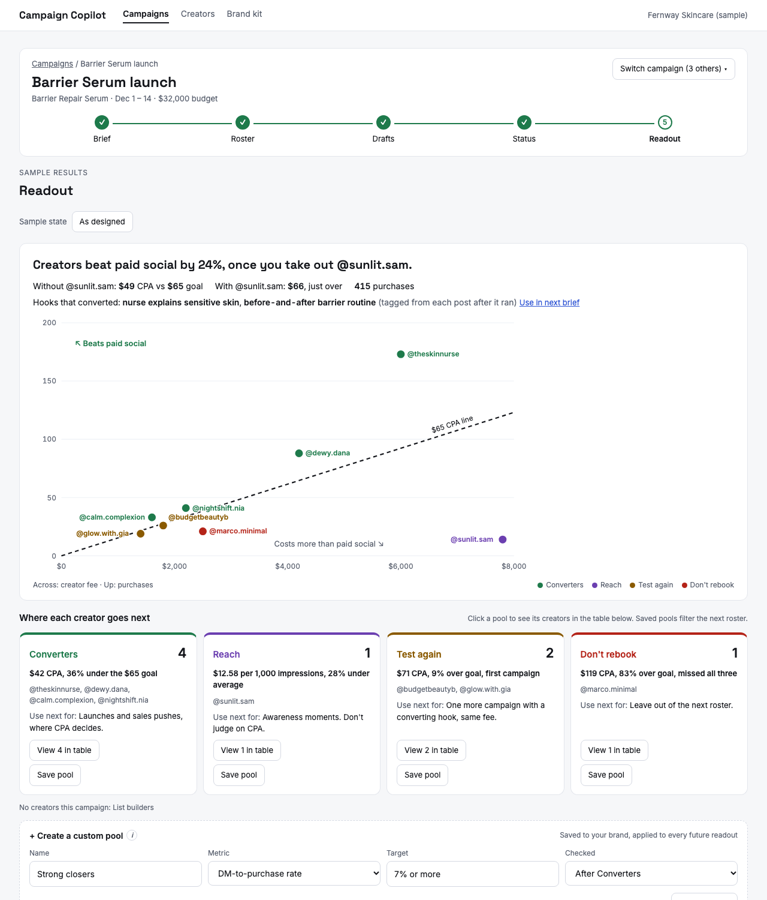
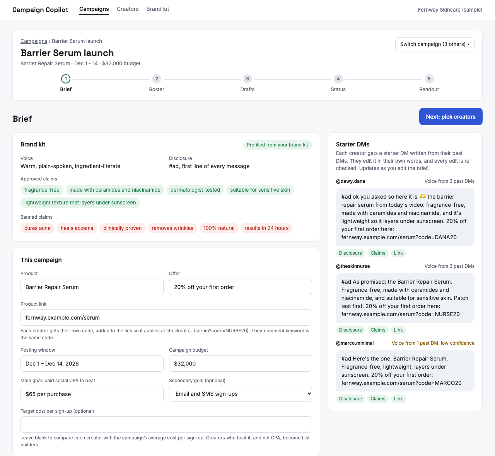
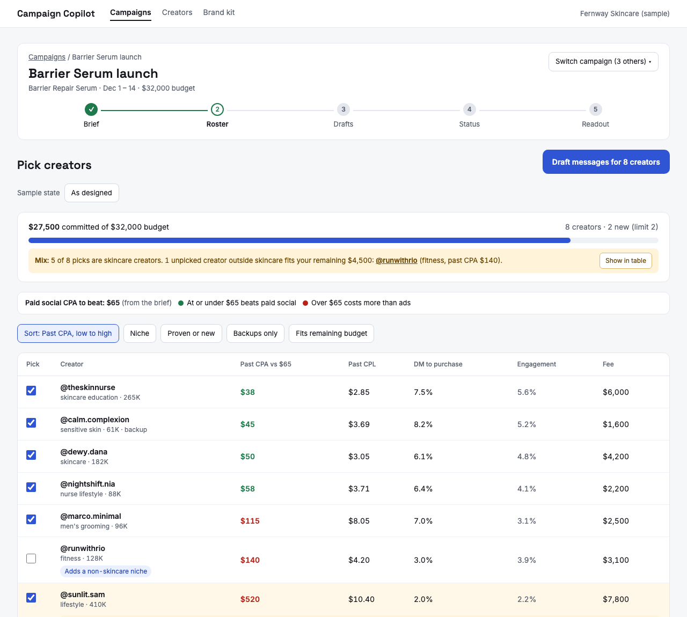
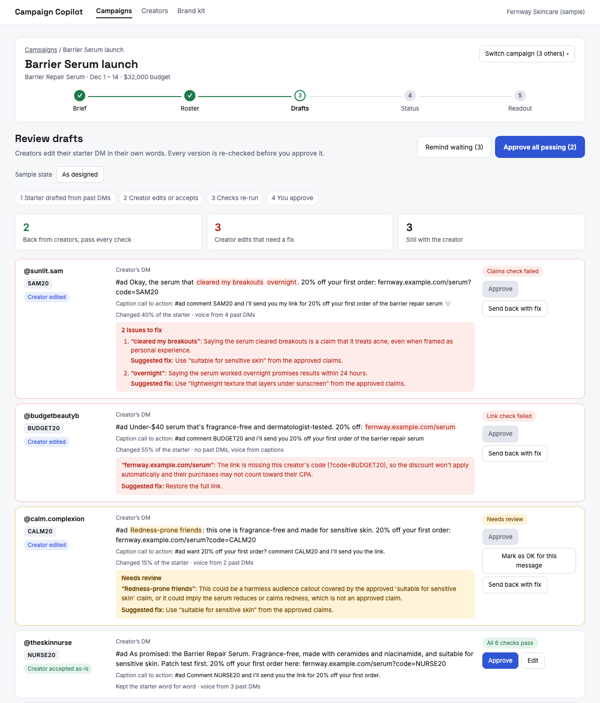
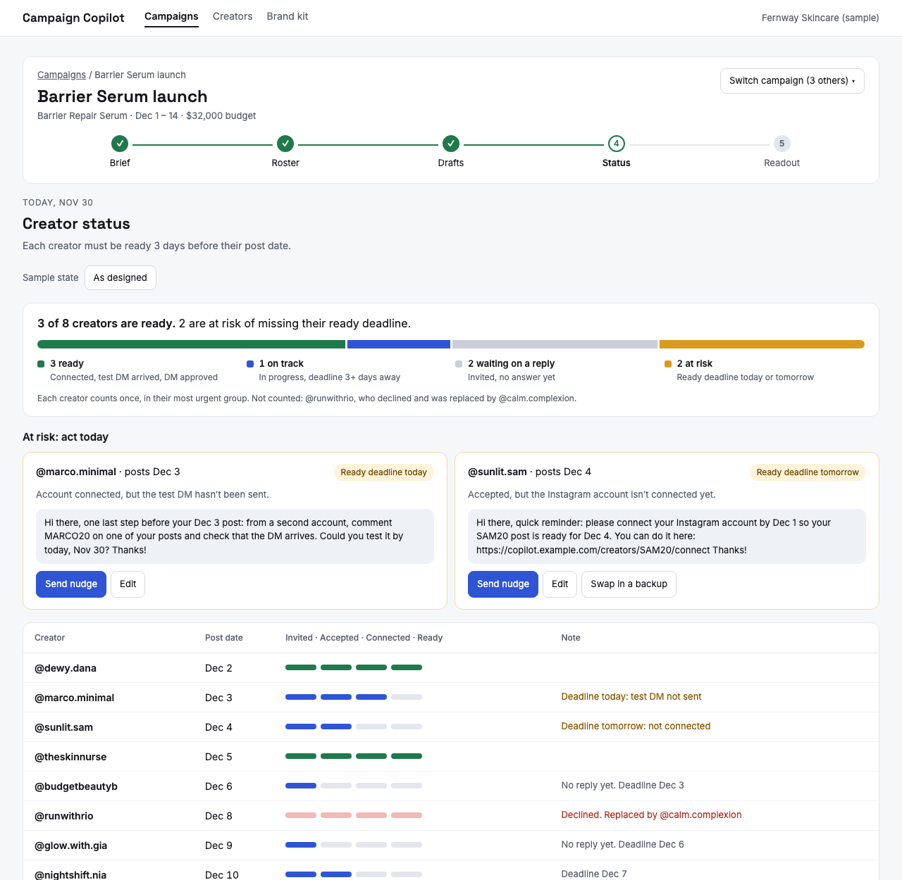
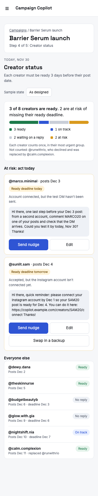
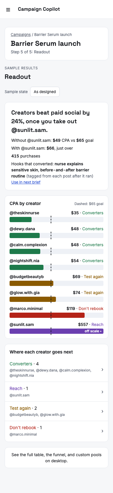

# Creator Campaign Copilot

**Try it: [creator-campaign-copilot.vercel.app](https://creator-campaign-copilot.vercel.app)**

Launch an influencer campaign across a whole creator roster in minutes, with every message checked before it goes out, then see which creators actually drove action.

**Status:** working prototype. All brands, creators, and results are fictional sample data. The public link runs in demo mode: the AI output it shows was generated once from the real prompts and reviewed before it was committed (see [Decisions](docs/DECISIONS.md)), so nothing you click calls the API.



## Why I built it

Brand teams that use comment-to-DM automation in creator campaigns repeat the same setup for every creator: a keyword, a message, a check that the creator's account is connected. Then they wait on a dashboard to tell them who worked. I wanted to see how much of that an AI could draft and check, and where a person still needs to approve.

## What it does

1. **Brief in:** product, offer, link, approved and banned claims, posting window, the paid social CPA to beat, and an optional sign-up goal.
2. **Pick creators:** past CPA with this brand against the benchmark, with budget, new-creator, and niche-mix warnings that name the fix.
3. **Drafts, checked on every version:** each creator gets a code and a starter DM written from their own past DMs. They edit it in their own words, and every version is re-checked: disclosure, link, keyword, and length in code; paraphrased or unapproved claims by Claude. A person approves, and an unsure call goes to a person, not through.
4. **Creator status:** who's ready, who's at risk of missing their deadline, and a nudge drafted for each.
5. **Readout:** whether creators beat paid social, a scatter of fee against purchases, and a pool for each creator (Converters, List builders, Reach, Test again, Don't rebook) by an exact rule, so the next roster starts from proven groups.

| Brief | Pick creators |
|---|---|
|  |  |
| **Drafts and checks** | **Creator status** |
|  |  |

Status and the readout are built for a phone too, since that's where a brand checks them:

<p>
  
  
</p>

The empty, loading, and error states (a first campaign with no history, starters being written, a model call that fails, an account that disconnects, results still coming in) can be previewed in the sample campaign with the **Sample state** picker.

## Run it

Needs Node 22 or later.

```bash
npm install
npm run dev
```

Then open http://localhost:5173. The app runs on the sample data and the cached AI output; no API key is needed.

| Command | What it does |
|---|---|
| `npm run dev` | The app, with hot reload |
| `npm test` | Unit tests (Vitest): checks, metrics, pools, readiness, states, and the API functions |
| `npm run test:e2e` | End-to-end and accessibility tests (Playwright and axe) against a production build. Run `npx playwright install chromium` once first. |
| `npm run evals` | The message-check eval set. Exact checks always run; the claim judgment runs when `ANTHROPIC_API_KEY` is set. |
| `npm run typecheck` | TypeScript across the app, API, scripts, and tests |

**Calling Claude for real:** the API is only called from serverless functions in `/api`, never from the browser. They read `ANTHROPIC_API_KEY` from the environment and stay off unless `LIVE_AI_ENABLED=true` (see `.env.example`). Never commit a key.

## How it's built

- **App:** React, TypeScript, and Vite, deployed on Vercel. Every merge to `main` deploys; every pull request gets a preview link.
- **AI:** Claude (`claude-opus-5-5`) for starter DMs, claim judgments, and nudges, with structured outputs. Prompts are in [docs/PROMPTS.md](docs/PROMPTS.md).
- **What code decides:** every exact check, every metric, readiness, and pool assignment. The model only makes judgment calls, and each one has an eval.
- **CI on every pull request:** type check, unit tests, end-to-end and accessibility tests, and the evals.

## Docs

- [Product brief](docs/PRODUCT.md): how campaigns work, the problems, goals, and success metrics
- [Decisions](docs/DECISIONS.md): what I chose and why, newest first
- [UX spec](docs/UX_SPEC.md): the screens, their jobs, and the design principles behind them
- [Build plan](docs/BUILD_PLAN.md): stack, workflow, screens, data model, build order, and hosting
- [Prompts](docs/PROMPTS.md): every AI call, its inputs, and its exact output
- [Testing and evals](docs/TESTING.md): what's tested now, and the plan with more time
- [Evals](evals/README.md): the message-check cases and every run's results
- [Design](design/README.md): every screen, as source and as rendered images
- [Sample data](data/README.md): what each file holds
